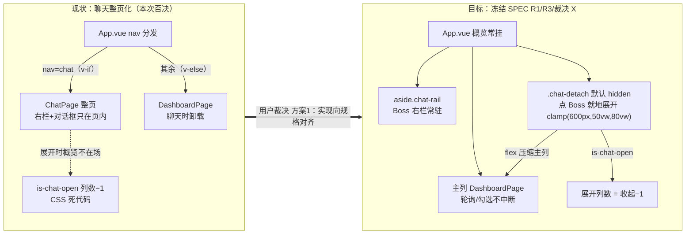

# ADR-004：聊天编排回归冻结 SPEC——否决整页化，落实同屏常驻与就地展开

> 状态：**Accepted**（2026-11-23 用户裁决「方案 1」，Chief 群内传达）
> 日期：2026-11-23
> 决策者：用户
> 提出与复核：存量架构设计（只读勘探，代码实证）；熔断上报：有稿设计；复核确认：Chief
> 相关：[`UI-SPEC-chat-detach-v3`](../ui/UI-SPEC-chat-detach-v3.md)（冻结真源，一字不动）、[`ADR-003`](ADR-003-frontend-leptos-to-vue.md) / [`ARCH-003`](../architecture/ARCH-003-vue-frontend-migration.md)（整页化的迁移继承来源）、[`SPEC-001-legacy-chat-merge`](../specs/SPEC-001-legacy-chat-merge.md)（实施图纸）、[`frontend-vue/HANDOFF.md`](../../frontend-vue/HANDOFF.md)

---

## 1. 背景（触发与证据）

有稿设计按冻结 SPEC 做像素级对齐时发现结构性偏差，按熔断规则上报；Chief 复核 SPEC 原文确认非误报；存量架构设计读代码定谳。证据基线：分支 `rust-rewrite`，HEAD `a4bb3d5`，`git status --porcelain` 空。

| # | 证据（文件:行） | 事实 |
|---|---|---|
| 1 | `frontend-vue/src/App.vue:41-51` | `ChatPage v-if="nav==='chat'"` 整页替换，概览走 `v-else` 分支——聊天时概览**卸载**；第 9 行注释自认「`chat` 整页替换」。整页化是迁移期**有意写下的选择**，但无任何用户裁决记录 |
| 2 | `frontend-vue/src/pages/DashboardPage.vue:596-601` | `onGreet` 存草稿后 `emit('navigate','chat')` **切页**；SPEC §16.5 要求 `greetFromJob` 就地 `openChatDetach()` → `pickFriend(uid)` → 预填输入框 + `focus()`，不自动发送、不换页 |
| 3 | `frontend-vue/src/pages/ChatPage.vue:530-627` | 右栏 `aside.chat-rail` 与 `.chat-detach` **只存在于聊天页内**；概览页无右栏 → 违反 R1（Boss 列表默认常驻于概览同屏） |
| 4 | `frontend-vue/styles/vue-dashboard.css:187-206` | `.app-shell.is-chat-open .job-grid` 列数 −1 规则**已写好**，但展开时概览已卸载 → **死代码**，裁决 X 未生效 |
| 5 | `docs/adr/ADR-003` / `docs/architecture/ARCH-003` | 均无聊天形态裁决；ARCH-003 §3.4 按 Leptos 四页结构 1:1 直译——整页 chat 是**迁移继承**，不是被裁决的偏差 |
| 6 | `docs/ui/UI-SPEC-chat-detach-v3.md` §0/§1 | R1–R6 为用户逐字裁决；§1 明确**废止**「chat 整页保留为『展开』视图」（legacy-baseline §5.4），Q-2「右栏常驻、不整页跳转」结论继续有效 |
| 7 | `frontend-vue/HANDOFF.md` §1 几何轮 | 先例裁决「**补齐实现，规格不动**」——规格与实现冲突时，用户已选择让实现靠拢规格 |
| 8 | 全 `src/` grep | 四个废止 testid（`chat-rail-expand-btn` / `chat-detach-back-btn` / `chat-detach-side` / `chat-detach-l2`）命中 **0**，A11 已满足，保持即可 |

**定性**：实现偏离冻结规格（编排层），**不是代码契约冲突**——SPEC §8/§16.8 自证零新增 invoke、零配置键、零 sidecar 协议变化、零路由命令变化，后端一行不动。工作区干净，既有提交均过门禁，**不回滚**。

**附带文档偏差**（随改造里程碑修正，不在本 ADR 内改文件）：`frontend-vue/HANDOFF.md` §1「概览常挂 + 聊天/配置/日志浮层」与代码不符——只有 config/logs 是浮层，chat 是整页替换。

## 2. 决策

**实现向冻结 SPEC 对齐，SPEC 一字不动。**

1. **否决聊天整页化**。R1–R6、§1 废止条款、裁决 X 持续有效，必须落地。
2. 目标编排：概览**常挂**（轮询/勾选/滚动不中断）+ Boss 右栏**同屏常驻** + 点 Boss **就地展开** `.chat-detach`（`.app-body` 的 flex 子项、`position: static`、宽 `clamp(600px, 50vw, 80vw)`）压缩主列 + 展开态列数 = 收起态 − 1 + 顶栏合并回单行（原型口径）。
3. 执行 lane：**前端编码**单线程写 `frontend-vue/`（编排改动，超有稿设计「不动业务逻辑」红线）；门禁绿后**有稿设计**接手 A–H 像素修复；再后**前端打磨**视觉收尾。后端 / scraper 零改动。
4. 实施图纸、改动文件清单、可量化 AC、回滚方案见 [`SPEC-001-legacy-chat-merge`](../specs/SPEC-001-legacy-chat-merge.md)。

## 3. 后果

**正面**：规格权威恢复，原型 1:1 可对齐；`is-chat-open` 死代码复活；「边看岗位边聊」的核心 UX 成立；后端契约面零风险；组件层（ChatDetach / FriendList 双前缀 / AutoApplyBar 二选一搬移 / ChatCompose）与几何（`--detach-w` clamp、`--ui-scale`）**已就位**，改造集中在编排提升，属最小入侵。

**负面 / 代价**：`App.vue` / `ChatPage` / `DashboardPage` / `AppShell` 挂载关系重写；vitest 结构性断言随编排改写（C1–C17 契约断言一条不少）；`nav-chat` / `page-chat` 锚点随整页退役，QA 需重锚；自动投递队列与 greet-draft 生命周期随层迁移，须保 C16（WebView 挂起定时不触发）语义。

**后续任务**：前端编码按 SPEC 实施 → QA 重锚 + 零 Mock 验收 → 有稿设计 A–H → 前端打磨收尾 → `frontend-vue/HANDOFF.md` 同步（含 §1 口径修正）。本次为前端模块内改造，预期不动根 §0 跨模块看板。

## 4. Non-goals

不动 SPEC 与原型；不动后端 / scraper / 三条契约；不做 Liquid Glass L2/L3；不做 A–H 像素差距（下一里程碑）；不新增依赖、不新增字号档位（5 档封顶）、不新增路由命令；不写 `data/*.db`。

## 5. 备选与否决

**方案 2（追认整页化、修订 SPEC）——用户否决。** 理由：等于废止用户逐字裁决 R1/R3/§1/裁决 X；chat-detach 的核心 UX（同屏压缩投递列表）落空；原型与实现永久背离，后续每轮对齐都要推翻裁决。

## 6. 实施与回滚

- **实施**：见 SPEC-001（文件清单 / 里程碑 / AC / 风险）。顺序硬约束：前端编码门禁绿之前，有稿设计与前端打磨不写 `frontend-vue/`。
- **回滚**：改造仅 `frontend-vue/`，`git revert` 对应提交即整体还原；无数据迁移、无后端联动、无配置键变化。回滚后整页化复现（偏差回到熔断前状态），须重新裁决，不得静默恢复。
- **门禁**：根 §5 槽位 A 全项（独占 `CARGO_TARGET_DIR`）+ `npm run typecheck` + `npx vitest run` 全绿；改 CSS 后 `npm run build` 并数 `dist/assets/*.css` 选择器；交付前槽位 C 产物冒烟（工作区外产物）。

## 7. 现状 / 目标对比图

## 8. Verification（决策级）

- [ ] SPEC-001 全部 AC 通过（R1/R3/R6/裁决 X/greet 就地链/状态机/唯一状态条）
- [ ] 槽位 A + typecheck + vitest 全绿；C1–C17 契约断言一条不少
- [ ] 四个废止 testid 命中保持 0；新增锚点按 SPEC §4 终表落地
- [ ] 槽位 C 产物工作区外冒烟通过
- [ ] `frontend-vue/HANDOFF.md` §1 口径修正随里程碑落盘
- [ ] 二级导航撤除（用户裁决 5）：NAV 4 项 / `nav-*` / `page-*` / Vue 侧 `nav-tabs` 残留命中 0，三入口保留（右栏 / 顶栏配置 / 日志卡头部决策记录）

## 9. 追加裁决（2026-11-23 用户裁决 · 二级导航撤除，Chief 群内传达）

1. **用户裁决：撤除二级导航**（概览｜Boss 消息｜配置｜决策记录），照原型「用户裁决 5」1:1 执行，**不保留页签、不做动作化改造**。原型原文（`prototypes/ui-v1/index.html` L1413–1415，已核）：「二级导航……已移除。Boss 消息在右栏，配置在顶栏右侧，决策记录在底部日志卡头部 —— 入口都还在，只是不再单起一行。」
2. 落地范围：`lib_ui/nav.ts` 的 4 项 NAV、`navTestId`/`pageTestId` 与 `nav-<slug>`/`page-<slug>` 锚点、Vue 侧 `nav-tabs` 残留规则一并清理；`nav.test.ts` 四串逐字断言随之重锚。**入口保留**：Boss 消息=右栏、配置=顶栏右侧 `shell-config-btn`、决策记录=日志卡头部（新增入口，开 logs 浮层窗）。`page_tick` 语义保留（概览恒不重拉，判据与订阅同源）。
3. **F 类顶栏单行合并归前端编码**（Chief 明确）：左平台卡 · 中 `.nav-mid` · 右 `.tb-tail{margin-left:auto}`（原型 L505–513）与结构改造同一批 DOM，同一次改动做掉；有稿设计只收剩余像素项。
4. **顺序硬约束（以 Chief 为准）**：架构落文档 → 前端编码（结构+顶栏合并+撤导航）→ 门禁全绿 → 有稿设计剩余 A–H → 前端打磨视觉收尾 → QA 重锚。存量架构设计此前「A–H 可先修」的放行**作废**。
5. **原型零写入**：`prototypes/` 为冻结真源，其自身 L356 的 `nav-tabs` 遗留规则属历史痕迹，不动；清理对象是 Vue 侧副本。
6. SPEC-001 已同步修订 **Rev 2**：AC9（撤导航）、回滚范围含撤导航、QA 重锚清单点名。