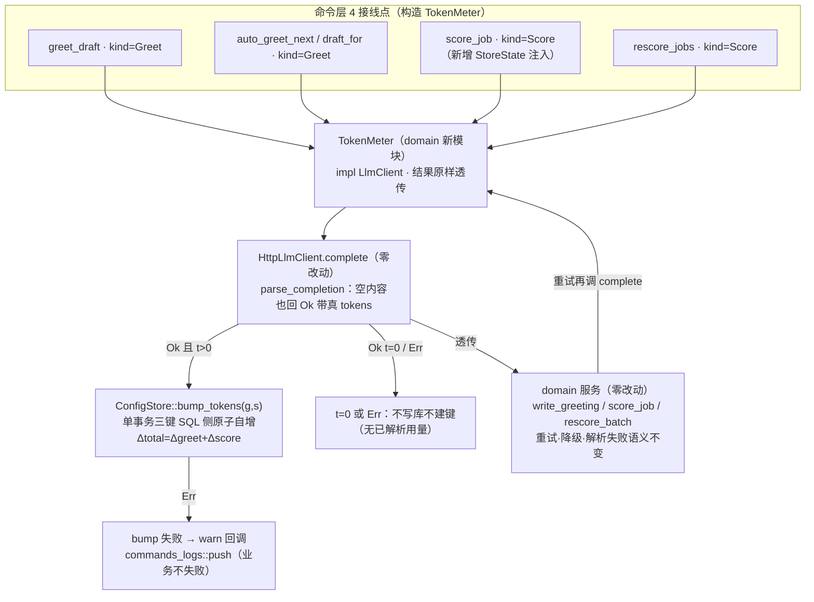

# ADR-005: 在 LlmClient 边界累计 token 计数（tokens_total / tokens_greet / tokens_score）

- Status: Accepted（Chief 2026-11-23 派单授权；范围与写入时机由存量架构设计裁定；优先级「M4 之后、可与 M4 并行」为 Chief 裁决）
- Date: 2026-11-23
- Deciders: Chief（派单/优先级）、存量架构设计（范围/时机/口径裁决）、后端编码（只读勘探输入）、前端编码（偏差②事实更正 `76685f1`）
- 实施 lane：后端编码（本 ADR 冻结前零写入）；代码只读约束适用于架构 lane 自身

## Context

顶栏「模型打分/打招呼」分项 stats 读数恒为旧 Python 库遗留值或 0。经只读勘探核实（行号为当前 HEAD 真值）：

1. **DTO 已下发三键**：`commands_config.rs` L58–60 字段、L126–128 读取；前端 `frontend-vue/src/api/types.ts` L290–292 类型已在。「后端未下发」不成立（前端编码已更正其 M2 报告，`76685f1`）。
2. **三键是只读派生键，不是可写键**：`store_ports.rs` L216–223 `CONFIG_READ_ONLY_KEYS` 明文列入；`commands_config.rs` L185 文档「`tokens_*` / `min_score` / `data_dir` 一律忽略」+ L385 守卫测试「只读键不得被写」。`WRITABLE_KEYS` 不含三键，经 `set_app_config` 写入会被静默跳过（根 AGENTS §2 静默失效 2）。
3. **核心无累计写入路径**：`KEY_TOKENS_*` 全仓引用仅读取处；greet/score 逐次 `tokens` 只回传不落库；`jobs.token_used` 列仅声明（`schema.rs` L134）无写入，`Job` 实体与 `SELECT_COLUMNS` 均不含它。
4. **token 唯一来源**：`infra/llm.rs` `parse_completion` L91–97 抽 `usage.total_tokens`。**空内容响应也返回 Ok 并带真实 tokens**（L173–183 测试：content=""、finish="length"、tokens=1600）；`LlmError::Unparsable` 是 domain 在收到 Ok 之后自行构造的（`scoring_llm.rs` L368），不是 infra 解析失败。
5. **4 个产生点**（`ingest.rs` 纯规则打分不调 LLM，L13/L155，0 token，无需接）：
   - `greet_draft`（`commands_greet.rs` L119，已持 store）→ `write_greeting`
   - `auto_greet_next`（`commands_auto.rs` L222，已持 store）→ `draft_for`（L161–173）→ `write_greeting`
   - `score_job`（`commands_db.rs` L398，**签名无 StoreState**）→ `scoring_service::score_job`
   - `rescore_jobs`（`commands_db.rs` L525，已持 store）→ `rescore_batch`（逐条调 `score_job`，`RescoreOutcome` 无 tokens 字段，逐条消耗被整个丢弃）
6. **按回传值累计会系统性少计**：话术两档预算重试 `[1200, 3000]`（`greeting.rs` L344/L369–400）与打分重试 `[1600, 3200]`（`scoring_llm.rs` L354–388）只把**最后一轮成功**的 tokens 写进回传；失败/空内容降级一律回传 `tokens: 0`（`greeting.rs` L411、`scoring_service.rs` L126–130）。推理型模型思考吃光整档预算时**实际消耗最大、回传恰为 0**——这正是两档重试机制存在的理由，少计不是边缘而是主场景。
7. **并发现状**：`SqliteStore` 为 `Mutex<Connection>`（`admin.rs` L453 等）；读侧 `read_config` 一次 `config_pairs()` 带出全部键（`commands_config.rs` L68–87），`num()` 对缺失/空/非数字一律 `unwrap_or(0)`。
8. **日志先例**：`commands_logs::push`（L26–30）成文约定「记日志永远不该让业务失败」。

## Decision

**累计点置于 `LlmClient::complete` 边界**：新增 domain 装饰器 `TokenMeter`（实现 `LlmClient`，结果原样透传），由命令层在 4 个接线点按用途构造（`TokenKind::Greet` / `TokenKind::Score`）。凡内层返回 `Ok((_, _, t))` 且 `t > 0`，**同步**调 `ConfigStore::bump_tokens(g, s)` 一次（Greet → `(t, 0)`，Score → `(0, t)`），然后原样返回内层结果。重试、降级、解析失败、发送失败都不影响计数——每个已解析用量的 HTTP 响应各计一次。

**落库**：`ConfigStore` 端口新增 `fn bump_tokens(&self, greet: i64, score: i64) -> Result<(), Self::Error>`（实现方恰 2 处：`SqliteStore` + `commands_greet.rs` L238 测试桩）。`SqliteStore` 实现＝**单次锁获取 + 单事务 + 三条 upsert**，算术在 SQL 侧（禁止 Rust 侧读改写）：

```sql
INSERT INTO app_config (key, value) VALUES (?1, ?2)
ON CONFLICT(key) DO UPDATE SET value = CAST(COALESCE(NULLIF(TRIM(value), ''), '0') AS INTEGER) + ?2
```

三键同事务：`tokens_total` delta=g+s、`tokens_greet` delta=g、`tokens_score` delta=s。**Δtotal = Δgreet + Δscore 恒成立**；读方永不见半更新态。delta=0 的键跳过语句；双 0 为 no-op（不写库、不建键、不补 0）。?2 绑 i64（TEXT 亲和列入库自动转文本，与 `num()` 读法兼容）；非数字遗留值经 CAST 归 0，与读侧 `unwrap_or(0)` 同口径。upsert 形状照抄现有 `set_config`（`admin.rs` L466–474）。

**口径**：
- 计数时机＝token 一经产生即累加，与业务成败无关（发送失败也计，已计费）——采纳后端编码提案。
- 遗留值**只增不清**：不重置、不回填、不造数。历史 `total ≠ greet + score` 的差额原样保留，仅新增量满足可加性。
- `t = 0`（usage 缺失）或 `Err`（Transport / NotConfigured，无已解析用量）不计数。
- bump 失败**不得使业务失败**：经命令层注入的 warn 回调走 `commands_logs::push("warn", …)`（domain 不得向上引用命令层，回调解耦；先例＝push 自身的「记日志永远不该让业务失败」）。不得静默吞。
- `score_job` 保持**不可失败签名**（现返回 `ScoreReply` 非 `CmdResult`）：store 获取失败 → warn + 透传裸 client（该次计数降级，打分行为零回归）。其余 3 点 store 已在手。
- `reply.tokens` 语义**不变**（＝归属于本次成功生成的消耗）；计数器语义＝计费口径。两者语义分离是有意设计，不得为对齐而改回传或降级语义。

**不变量（零改动面）**：打分决策顺序（`scoring_service.rs` 头注「不可重排」）、两档预算重试、降级语义、`WRITABLE_KEYS`、`CONFIG_READ_ONLY_KEYS`、全部 reply DTO、前端 `types.ts` / invoke 载荷、`generate_handler!` 注册。`score_job` 新增 `tauri::State<StoreState>` 参数由 Tauri 注入，**不进载荷、不改注册**，故 `lib.rs` 零触碰（已核）。

### 影响链路图



## 对后端编码四问的裁定（2026-11-23）

1. **① 可写范围**：批准，但按本 ADR 修正——原拟 8 文件中 `domain/rescore.rs`、`domain/app_config.rs` **移出**（meter 透明覆盖 rescore 逐条调用，无需改 `RescoreOutcome`；键常量已在，无需新纯函数），换入 `domain/token_meter.rs`（新）与 `domain/mod.rs`（注册）。终版 8 文件见 Implementation Plan。**🔒 六单点零触碰批准**（`lib.rs` / `tauri.conf.json` / `Cargo.toml` / `schema.rs` / `protocol.rs` / `scraper/sidecar.py`；token 不过 sidecar 协议，无 DDL，零新依赖，State 注入不改注册）。
2. **② `jobs.token_used` 本批不动**：批准。理由更正——纯写 UPDATE **不需要**动 `schema.rs`（列已声明 L134）也不需要 `row.rs` 读映射；真正约束＝无消费方（前端 Job DTO 无该字段）＋逐岗归因需要调用点上下文（greet 试算 `job_id` 可为空）＋读回才触 `row.rs` 列锚点与列数测试。出现消费方时另开里程碑，由用户裁。
3. **③ 真实计费口径不另立里程碑**：本批即真实口径。依据＝Context 4/6：`parse_completion` 对空内容仍回 Ok 带真 tokens，`Unparsable` 系 domain 后置构造——边界 meter 在 domain 丢弃之前已捕获全部已解析用量（含两档重试的每一轮）。决策顺序与降级语义零改动。剩余**固有边缘**记为已知限制（见 Consequences），不是待办里程碑。
4. **④ 必须同一事务**：「同一次调用内分别自增」（三条独立语句）否决——语句间中间态可被 `read_config` 读到，且各自抢锁。单锁获取 + 单事务三 upsert（参照 `migration.rs` 整体事务先例，根 AGENTS §7.1）。

## Consequences

- 分项读数真实：推理模型重试/降级的消耗不再漏计；rescore 全批 LLM 消耗透明累计；前端 M3 接展示即得「遗留值 + 真实新增量」，无需等后端。
- 语义分离：`reply.tokens`（本次成功生成归属）与计数器（计费口径）数值可能不同——文档化，QA 不得拿两者互验。
- 已知限制（固有，不另立里程碑）：a) Transport 错误（超时/网络）时服务端可能已计费但无 usage 可解析，不计；b) 进程在响应与事务提交之间崩溃，丢 ≤1 次调用的计数。两者均为少计、非造数；精确一次语义需 outbox 机制，属过度设计（Non-goal）。
- 后续任务：后端编码按本 ADR 实施（M4 之后开工，可与 M4 并行）；QA 按 Verification 验收；前端打磨 M3 接分项展示（纯前端，DTO 现成）。

## Non-goals

- `jobs.token_used` 逐岗写入/读回（无消费方；另里程碑须用户裁）。
- `reply.tokens` / `GreetReply` / `ScoreReply` / `RescoreReply` 任何形状或语义改动。
- 打分决策顺序、两档预算重试、降级语义、`LlmError` 枚举改动。
- `WRITABLE_KEYS` / `CONFIG_READ_ONLY_KEYS` / `set_app_config` 行为改动（只读守卫必须保持绿）。
- 精确一次计数（outbox/WAL 队列）、Transport 边缘计费推测、遗留值重置/回填。
- 前端任何改动（types.ts 字段已在；展示接线归 M3 前端打磨，另 lane）。
- 新增第三方依赖、新增 Tauri 命令、sidecar 协议改动。

## Alternatives considered

- **A+ 按回传值累计（后端编码原拟）**：命令层按 `reply.tokens` 累加 + `RescoreOutcome` 加 tokens 字段。否决——Context 6 的系统性少计（重试只计末轮、降级回传 0、推理模型空内容烧满预算恰回传 0）；需改 `rescore.rs` 结构；且「真实计费口径」被迫另立里程碑二次返工同一批文件。边界 meter 一批全捕获，`rescore.rs` 零改动。
- **C 用途专属 client 实例**：`LlmState` 改持 greet/score 两个带标签 `HttpLlmClient`，infra 内部累计。否决——`LlmState` 形状、`build_llm_client`、全部 lock 点连锁改；用途耦合进 infra；配置变更重建路径翻倍。meter 逐调用借用，天然新鲜，零连锁。
- **D infra/llm.rs 内部直接累计**：单共享 client 无法区分用途；给 `complete()` 加 purpose 参数则改 domain 端口签名，全部实现方与测试连锁。否决。
- **把三键加入 WRITABLE_KEYS 走 set_app_config**：破坏只读守卫（L385 测试）与 C11 配置契约，且前端整份回传会误写。否决。

## Implementation Plan

- **Affected paths（可写范围，恰 8 文件，均非 🔒）**：
  1. `backend-tauri/src/core/domain/token_meter.rs`（新：`TokenKind` + `TokenMeter<'a, S: ConfigStore>`（持 `&'a dyn LlmClient`、`&'a S`、kind、warn 回调 `&'a dyn Fn(&str)`）+ `impl LlmClient` + 单测）
  2. `backend-tauri/src/core/domain/mod.rs`（`pub mod token_meter;`，照 L6–20 字母序插入）
  3. `backend-tauri/src/core/domain/store_ports.rs`（`ConfigStore` 加 `bump_tokens` 签名；doc 注明「内部计数专用，不经 set_app_config，三键仍属 CONFIG_READ_ONLY_KEYS」）
  4. `backend-tauri/src/core/infra/sqlite/admin.rs`（`SqliteStore` 实现：单锁 + `conn.transaction()` + 三 upsert + commit；照 L466–474 形状与 `?1..?N` 命名占位符约定）
  5. `backend-tauri/src/commands_db.rs`（`score_job` 加 `store_state: tauri::State<'_, StoreState>`；两处包 meter：`score_job` L399–405、`rescore_jobs` L531–546 闭包内；store 失败 → warn + 裸 client，签名保持不可失败）
  6. `backend-tauri/src/commands_greet.rs`（`greet_draft` L158–168 包 meter；L238 测试桩补 `bump_tokens` 实现）
  7. `backend-tauri/src/commands_auto.rs`（`auto_greet_next` L289–293 块内包 meter 再传 `draft_for`；`draft_for` 本体与其测试 L522 不动）
  8. `backend-tauri/src/core/infra/sqlite/tests.rs`（落库测试，见下）
- **Pattern to follow**：domain 装饰器实现 domain 端口（纯组合，IO 走端口，禁 rusqlite/ureq/tauri）；命令层构造与注入（编排，非领域规则）；warn 回调照 `commands_logs::push` 先例；事务照 `migration.rs` 整体事务先例；临时库测试照 `infra/sqlite/tests.rs` 既有形状（显式 `$env:TEMP`）。
- **Tests**：
  - `token_meter.rs` 单测（mock LlmClient + mock ConfigStore 记录调用）：Ok t>0 按 kind 记一次且分量正确；Ok t=0 不记；Err 不记；连续两次 Ok（模拟重试）记两次；bump Err → warn 恰一次且内层结果原样透传。
  - `infra/sqlite/tests.rs`：遗留值保留（先置 "100" 再 bump(5,0) → 105）；缺键仅 delta>0 创建；delta=0 不建键；非数字遗留值 CAST→0+delta（与 num() 同口径）；多线程并发 bump 终值=N×M（无丢增量）；Δtotal=Δg+Δs；`read_config` 回读一致。
  - 既有守卫必须保持绿：`commands_config.rs` L385（只读键不得被写）、`commands_db.rs` L845（规则打分不消耗 token）、greeting/scoring_llm/scoring_service 全部既有用例（domain 服务零改动）。
  - 真实库验证只在 `open_in_memory` 或 TEMP 副本（根 §3.5），验完删除。
- **Avoid**：Rust 侧 get→set 读改写（丢增量）；三条独立语句无事务（半更新态可读）；改 `rescore.rs`/`app_config.rs`/domain 服务/infra llm；给 `complete()` 加参数；动 🔒 六单点；动前端；delta=0 建键补 0；重置/回填遗留值；bump 失败冒泡进业务结果；静默吞 bump 错误。
- **Code → ADR 链接**：`token_meter.rs` 头注与 `bump_tokens` 实现处各留一行 `// ADR-005: docs/adr/ADR-005-legacy-token-accumulation.md`。

## Verification

- [ ] 独占 `CARGO_TARGET_DIR=%TEMP%\jt-backend` + 显式 `TEMP/TMP`，`cd backend-tauri; cargo test` 全绿（基线 392 只增不减，1 ignored=sidecar_smoke 不变）
- [ ] `cd frontend-vue; npm run typecheck` 0 错、`npx vitest run` 全绿（前端零改动，防误伤）；`python -m compileall -q scraper` 过
- [ ] `git diff` 核对：🔒 六单点零改动；`frontend-vue/` 本 lane 零改动；`WRITABLE_KEYS`/`CONFIG_READ_ONLY_KEYS` 原文未动
- [ ] 临时库冒烟：greet_draft(useLlm) → tokens_greet/total 增量=usage；score_job(useLlm) → tokens_score/total 增量；空内容 finish=length 重试场景计数>0 而 reply.tokens=0（语义分离成立）
- [ ] `set_app_config` 塞 `tokens_*` 仍被静默跳过（守卫测试绿）
- [ ] 并发 bump 无丢增量（多线程测试绿）；bump 失败注入 → 业务结果不变 + warn 日志一条
- [ ] 提交：角色身份 `git -c user.name="后端编码" -c user.email="dev@jobassistant.local" commit --only -- <恰 8 路径>`，前后 `git status --porcelain` / `git show --stat HEAD` 核对；未过槽位 A 禁 commit

## More Information

- 勘探与裁决过程：群「开发流水线」2026-11-23（后端编码《开工前理解确认》+ 四问；存量架构设计只读复核全部行号真值）。
- 偏差②事实更正链：前端编码 M2 报告误称「后端未下发」→ 自查更正 `76685f1` → 本 ADR 复核采纳并修正其「可写键」表述（实为 CONFIG_READ_ONLY_KEYS）。
- SPEC-001 Rev 7 同步记录路由：分项展示归 M3 前端打磨（不等后端）；后端累计 M4 之后开工、可与 M4 并行（Chief 顺序）。