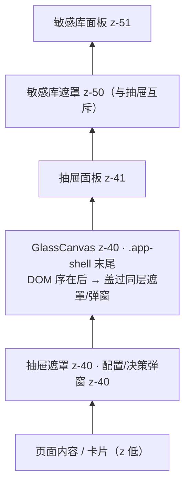

# SPEC-003-legacy · Liquid Glass L2/L3 可写范围与契约裁定（chat-merge 之外的独立前端轨）

- 状态：**冻结**（范围确认态；实施 lane＝前端编码，单写者。Chief 2026-11-23 统一验收裁决：槽位 A/B 门禁保留，每批槽位 C 冒烟与真窗口验收搁置至统一验收通知）
- 日期：2026-11-23
- 派单链：用户裁决「M4 收尾后直接进入 12345，不走 QA 和交付」→ Chief 派未决项 5 → 存量架构设计恢复规格＋确认可写范围（本 SPEC）→ 前端编码先 L2 后 L3
- 上游真源：[UI-SPEC-liquid-glass-l2-l3.md](../ui/UI-SPEC-liquid-glass-l2-l3.md)——已从提交 `d39bae4` **逐字恢复**（blob `c3fd9cf710a9ab15c2353deaf39c2561817b76a2`，工作树 hash 与源 blob 相等，全文 621 行）。**冻结原文不改写**；其以旧 Leptos `frontend/` 坐标写成（`.rs`/trunk/web-sys/Cargo.toml），坐标按「历史证据」处理（先例：frontend-vue/AGENTS.md 对 `.rs` 行号的口径），光学参数、铁律、批次闸门、§6 实测/未验证清单**全部持续有效**，Leptos→Vue 映射以本 SPEC 为准。
- 编号说明：SPEC-002 编号被历史打分规格引用（commands_db.rs 注释引其 §3.1/§3.3，文件不在库），本 SPEC 取 003 避让。

## 一、五问裁定（前端编码 2026-11-23 提请，逐条批准/修正）

### 裁定 1 · C4 14→15：批准，由前端编码追加
- 新样式表命名 **`styles/vue-glass.css`**（vue 系命名一致，红线 8 自动适用），作第 15 份追加 `styles/index.css` @import 链**末尾**（`vue-pages` 之后）。既有 14 条相对顺序不动；11 条契约序不动。
- **C4 实际宿主澄清**：14 条序的宿主是 `styles/index.css` 的 @import 链（`index.html` 无 CSS link，已核 L1–59）；C4 的 3 条内联 `<style>` 与首帧主题脚本不动。index.css 文件头 L8 本就明文「新样式表……追加到末尾，不要插在中间」。
- **「总控预挂、lane 不再改本入口」（index.css L25–26）是多 lane 并行防入口冲突的旧约定**；本批前端单写者、无并行前端 lane，例外成立：**前端编码在 L2-1 批内追加该 import**（含头部注释计数同步），架构 lane 代码只读、不预挂。
- 守卫同步（同提交）：`tests/geometry-collect.test.ts` L72「index.css 仍是 14 条 @import」→ 15 条（按本裁定更新，属落实批准增量、非自改基准）；`tests/chat-contract.test.ts` L324（vue-chat 在 11 条契约之后）不受影响、不动。
- AGENTS.md C4 措辞同步＝§3 契约增量（架构 lane 已落，见该文件 2026-11-23 增量块）。

### 裁定 2 · index.html 静态 `<svg><defs>`：批准
- 位置照规格 Q5：`<body>` 内、`#app` 之后、module script 之前；0×0、`aria-hidden="true"`、`position:absolute; left:-9999px`。深/浅两条湍流滤镜（`lg-turb-dark` / `lg-turb-light`）＋可选真斜面链 `lg-lens-drawer`（feImage href 由 TS 运行时注入 dataURL）。
- CSP 已核（tauri.conf.json L30）：`script-src 'self'`——svg 是标记非脚本，无碍；`style-src 'self' 'unsafe-inline'`——内联 style 属性放行；`img-src 'self' data: https:`——**feImage data: 贴图放行**（规格 5.1-② 前提满足）；**blob: 未放行，禁用的结论维持**。不手写 nonce（根 §3.1）。
- 文档级滤镜宿主的三条理由维持（规格 Q5）：全局解析一次被任意元素引用；组件卸载不丢滤镜（退出动画期间滤镜仍在）；首帧就有，不「先平后皱」。

### 裁定 3 · Leptos→Vue 映射：批准（下表）
| 规格落点（历史坐标） | Vue 落点（现行） | 分层依据 |
|---|---|---|
| `lib_ui/glass.rs`（detect/ThemeParams/normal_offset/IO≤12） | `src/lib_ui/glass.ts`（纯函数与常量）；DOM 编排可拆 `lib_ui/use-glass-*.ts` composable（先例：`use-canvas-scale`）或组件内部 | lib_ui 纯函数优先；composable 触 DOM 有先例 |
| `components/glass_canvas.rs` | `src/components/GlassCanvas.vue`：自读 DOM 几何（`.job-card` rect）＋自绘卡片层，**零 invoke、不 import features** | components→lib_ui/api；装饰组件自包含 |
| `shell.rs:153` 插组件 | `AppShell.vue` 的 `.app-shell`（`data-testid="app-root"`）内部末尾、`.app-body` 之后 | C13 安全：GlassCanvas 是组件非页面 |
| L2 克隆层插入 drawer/sensitive/card | 建议抽 `src/components/GlassClone.vue`（纯展示、aria-hidden、wrap+clone），三宿主复用：`JobDetailDrawer.vue` / `SensitivePanel.vue` / `JobCard.vue` | 纯展示组件；宿主只加类名与插槽 |
| Rust 侧职责 | TS：运行时探针打 `data-l2="off"` / `data-l3="off"` 到 `<html>`；克隆层 `--glass-x/y` 反平移（rect＋滚动偏移）；feImage href 注入 | 规格 Q5「只由 CSS 引用 filter」不变 |
| web-sys features / trunk / wasm≤40KB | **不适用**（无 wasm）。vite build＋**dist JS 增量 ≤40KB**（L2+L3 合计，规格 5.4-⑰ 的适配纪律；每里程碑报实测字节差） | 零新依赖：裸 WebGL2＋原生 SVG |
| `tools/gui_e2e.py`（已删） | `pointer-events:none` 断言＋真窗口 CDP 点击探针＋`qa-testids` 守卫；新锚点 **`glass-l3-canvas`**（规格 3.5） | 现行测试面 |
| `tools/check_layers.py`（已删） | AGENTS §2 分层 review 零新增违规（lib_ui 不反向引用；components 不 import features） | 现行分层铁律 |
| `cargo test` 宿主 85 例 | vitest（现基线 573，只增不减）＋typecheck 0 错 | 现行门禁 |
| REQUIRED_TESTIDS 16 项 | `qa-testids.test.ts` 现行冻结集＋新锚点 | 现行守卫 |
| `.tmp-test/l23/` 探针与产物 | **`%TEMP%\jt-glass-l23\`**（工作区外；红线 7 禁探针/桩入 `src/`；证据留 TEMP 照项目惯例，验完清理脚本） | M3 先例 |
| `generate_glass_map.js`（技能脚本，已核存在） | 离线数学参考（REFERENCE.md 光学真源）；**不 import 进产品构建**——数学移植 TS 或离线预生成贴图 dataURL | 技能文件非产品代码 |

### 裁定 4 · 红线 8 归属：确认
- `vue-glass.css` ＝ vue 系**第四份**，零颜色字面量零例外（规格 2.4 CSS 本无字面量，照抄即合规）；`tests/geometry.test.ts` L37 `VUE_CSS` 守卫 3→4 **同提交扩列**。
- L3 canvas 颜色＝运行时 `getComputedStyle` 读 token 计算值（自绘卡片层底色/高光边），**TS 无颜色字面量**——口径确认。
- 新令牌（如需）→ `tokens.css` **只追加不改既有值**（规格 §0 硬约束），照 C7 深浅两套；`--refract-edge`/`--refract-turbulence` 只消费不重定义。现值已核与规格一致：L79–80（深 14px/0.008）、L215–216（浅 5px/0.006）。
- **参数同源断言**（规格 5.4-⑯ 适配）：SVG 属性不吃 CSS 变量 → `ThemeParams` 常量与令牌字面量同源，vitest 以 `tokens.css?raw` 断言 `0.008/0.006/14px/5px` 四值相等；改令牌不改常量必须红。深/浅 `seed=11` 相同（切主题图案不跳变）。

### 裁定 5 · L3 z-index：按规格意图重推，批准
现栈（已核）：抽屉遮罩 40／面板 41（drawer.css L16/L40）；敏感库遮罩 50／面板 51（sensitive.css L22/L43，注释明文「两者由页面层保证互斥」）；配置/决策弹窗 40（vue-pages.css L46/L136）。

- **canvas `z-index: 40` ＋ 挂 `.app-shell` 末尾**：与抽屉遮罩/弹窗同层、DOM 序在后 → 绘在其上；**低于抽屉面板 41**——与规格旧栈 z-40 的意图（透镜紧贴抽屉面板之下、内容之上）等价。`position:fixed; inset:0; pointer-events:none` 照规格 3.5。
- 敏感库栈 50/51 在 canvas 之上：**L3 v1 ＝ 抽屉透镜**（规格批次 L3-1–L3-3 全部以抽屉为中心）；敏感库与抽屉互斥 → 敏感库开时透镜 inactive、canvas 空转，被盖无视觉冲突。记映射偏差，不改规格、不动契约栈。敏感库透镜若将来要做 → 另裁（涉栈调整）。
- 施工核验项：配置/决策弹窗与抽屉同开时，canvas 只在透镜矩形内绘制、其余全透明，目视确认无越界绘制；若有 → 弹窗开时暂停透镜（规格意图内的实现细节，不动契约 z 值）。

## 二、L2-0 能力闸门裁定（前端编码提案批准）
- **复用既有工作区外冒烟产物 `%TEMP%\jt-m1-smoke\jobassistant-app.exe`（M1 期，7,241,216 B）＋ CDP 注入探针**：批准。探针标的＝WebView2 运行时能力（supports×4、feTurbulence 像素差、webgl2、feImage data:），**与 app 代码版本无关**；CSP/亚克力/lib.rs 自 M1 以来零改动（提交链已核），同源成立。不编译后端 TDD 半成品。
- **闸门判定照规格**：`filter:url()` 像素差 > 0（不能只看 supports）→ 过，进 L2-1；不过 → 整层 `data-l2="off"` 降级路径＋**停手汇报**，不写一行 L2 正式代码。
- **统一验收裁决（Chief 2026-11-23）**：每批槽位 C 产物冒烟与规格 5.2/5.3 真窗口验收**搁置至统一验收通知**；正式产物验证 build（`npx tauri build --no-bundle`，工作区外产物）统一验收时执行。**L2-0 能力探针维持**——它是规格施工风险闸门（批次 L2-0「验证不过不写一行第二层代码」），不是验收，且复用旧产物零构建；探针结论不因搁置失效。
- 规格 §6.2 未验证项①–⑩施工时现场确认，结论与对策落 HANDOFF（③光栅缓存残留→换新 id；④rect 当帧值→慢放录屏；⑥亚克力色偏→alpha:false 兜底；余照规格）。

## 三、可写范围（前端 lane，单写者＝前端编码）
**新增**：`styles/vue-glass.css` · `src/lib_ui/glass.ts`（可拆 use-glass-* composable）· `src/components/GlassCanvas.vue` · `src/components/GlassClone.vue`（建议）· 对应 vitest 测试文件。
**修改**：`styles/index.css`（末尾追加 1 条 import＋头部计数注释）· `index.html`（svg defs 块）· `styles/tokens.css`（**只追加**新令牌）· `src/components/AppShell.vue`（末尾插 GlassCanvas）· `JobCard.vue` / `JobDetailDrawer.vue` / `SensitivePanel.vue`（glass-l2 类＋克隆层）· `tests/geometry-collect.test.ts`（14→15）· `tests/geometry.test.ts`（VUE_CSS 3→4）· `tests/qa-testids.test.ts`（glass-l3-canvas）· `HANDOFF.md`（映射偏差与 §6.2 核验结论）。
**零写入**：`backend-tauri/` · `scraper/` · `docs/`（冻结规格与本 SPEC 归架构 lane）· `prototypes/` · `src/api/`（**invoke 接线不动**，Chief）· `package.json`（零新依赖；禁 three.js/pixi/wgpu/html2canvas）· 11 份契约 CSS 既有规则与值（tokens.css 追加除外）· C4 三条内联 style · 🔒 后端六单点（自然不触）。
**给 `.card` 补 `overflow:hidden`**（规格 2.2-Q2 铁律 3）：现状核验后按规格落点改——若 `.card` 规则在契约 CSS（layout.css），属规格明文的必要样式改动，**随 L2-2 批落并记录**；不得借机改契约 CSS 其他规则。

## 四、里程碑与门禁（Chief：先 L2 后 L3；规格批次闸门维持）
1. **L2-0** 能力闸门（探针，零正式代码；旧产物复用见 §二）
2. **L2-1** defs＋vue-glass.css＋import 追加（守卫 15 同提交）
3. **L2-2** 抽屉 P0（两面板克隆层＋反平移＋主题切换复测）
4. **L2-3** 卡片 P1（JobCard＋IntersectionObserver 同屏 ≤12）→ **L2 收口提交**
5. **L3-1** 骨架（canvas＋清屏＋testid＋探针）
6. **L3-2** 折射本体（squircle SDF＋Snell＋UV 偏移→自绘卡片层→逐帧 rect 同步）
7. **L3-3** 预算与降级（rAF 开关/静止 500ms 降频/visibility 停/reduced-motion 不建 canvas/dpr≤2/实例≤64/data-l3 off）→ **L3 收口提交**

每批门禁（槽位 A/B，Chief 统一验收裁决保留、不放松）：typecheck＋vitest＋build 数选择器；改 CSS 后产物数选择器（红线 5）。真窗口验收（规格 §5.2/5.3）与槽位 C 冒烟 → 统一验收时执行；L2-0 施工探针见 §二。提交：角色身份 `--only` 精确路径、前后核对；每里程碑一个完整提交；未过槽位 A 禁 commit。

## 五、AC（规格 §5 二十项维持，工具映射见裁定 3；下列为硬判据摘要）
**执行时机（Chief 统一验收裁决）**：A1＝L2-0 施工闸门（动码前）；A9–A14＝静态判据，每批门禁；A2–A8＝真窗口判据，**标准冻结不降标，执行搁置至统一验收**。
- A1 L2-0 像素差>0（非仅 supports），不过整层 off 停手
- A2 `data-l2="off"` 截图与改动前逐像素一致（纯附加层证明，规格 5.2-⑨）
- A3 滚动 200px 克隆层无相对滑动（5.2-⑦）
- A4 深→浅→深图案不跳变不残留（5.2-⑧，seed 同）
- A5 canvas pointer-events:none＋`glass-l3-canvas` 锚点在＋DOM 点击可达（5.3-⑩ 适配）
- A6 抽屉关闭静置 30s drawElements=0（5.3-⑪）
- A7 快速开合 5 次边缘偏差 ≤1px（5.3-⑫）
- A8 reduced-motion → canvas 根本不创建（3.4）
- A9 dist JS 增量 ≤40KB（5.4-⑰ 适配，实测报数）
- A10 ThemeParams 与令牌字面量同源断言绿（5.4-⑯ 适配）
- A11 vue-glass.css 零颜色字面量（红线 8 守卫四份）
- A12 @import 15 条顺序守卫绿（C4 增量）
- A13 vitest 基线 573 只增不减、typecheck 0 错
- A14 src/ 无探针/桩（红线 7，5.4-⑱）

## 六、Non-goals
桌面折射（tokens 架构写死）；顶栏/遮罩/thead/auto 条的 L2（规格 Q1 不做表）；`backdrop-filter:url()`（实测无效）；blob: 贴图（CSP）；three.js/pixi/wgpu/html2canvas；tokens.css 既有值改动；invoke 接线；敏感库透镜（L3 v1 仅抽屉，另裁）；L1 重做（已完成）；规格原文改写；QA 重锚、每批槽位 C 冒烟与交付（Chief 统一验收裁决：搁置至统一验收通知；本 lane 收口＝里程碑提交＋槽位 A/B 绿，真窗口判据统一验收执行）。

## 七、回滚与熔断
- L2/L3 各里程碑独立提交 `git revert`；`data-l2/l3="off"` 运行时降级＝零残留关闭开关（A2 证明纯附加层）；无数据迁移、无后端联动、无配置键变化。
- 契约冲突（C4 序/红线 8/C13/testid/CSP/分层）→ 停工 `git status` 汇报 → 存量架构设计修订本 SPEC。

## 八、取证记录
- 规格恢复：`git restore --source=d39bae4 --worktree -- docs/ui/UI-SPEC-liquid-glass-l2-l3.md`；`git hash-object` 工作树 = `c3fd9cf710a9ab15c2353deaf39c2561817b76a2` = 源 blob，字节级一致；全文 621 行（前端编码此前只读取回 470 行系截断，复核以落盘文件为准）。
- 现状锚点（本 SPEC 裁定依据，均已只读核验）：index.html L1–59（无 CSS link、3 内联 style、首帧主题脚本）；index.css L8（追加约定）/L25–26（总控预挂旧约定）；tokens.css L79–80/L215–216；tauri.conf.json L30（CSP）；drawer.css L16/L40；sensitive.css L22/L38/L43；vue-pages.css L46/L136；geometry.test.ts L37/L136–137；geometry-collect.test.ts L72；chat-contract.test.ts L324；AppShell.vue L55–72；liquid-glass 技能三件在位。